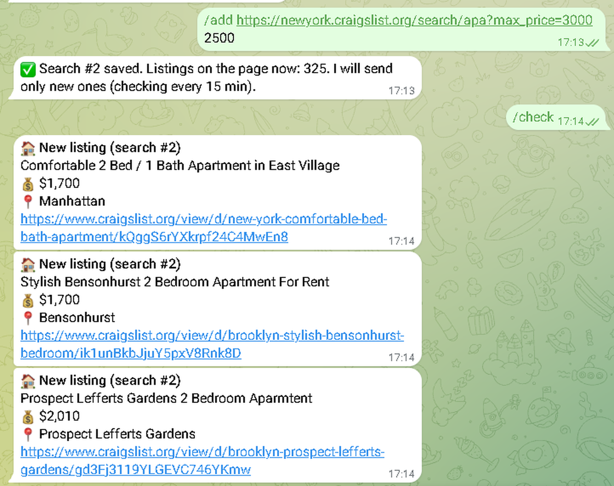

# Listings monitor bot for Telegram (Craigslist, Krisha.kz)

[](https://github.com/zhangir777/listings-monitor-bot/actions/workflows/ci.yml)

**Hire me:** [Upwork](https://www.upwork.com/freelancers/~012c68804f9b4d4550) · [Fiverr](https://www.fiverr.com/akhmetov_zhangi) · [Telegram @ZhangirAkhmetov](https://t.me/ZhangirAkhmetov)

**Live demo:** [@zhangir_monitor_bot](https://t.me/zhangir_monitor_bot) (runs when my demo server is on)

A Telegram bot that watches your Craigslist (or Krisha.kz) search and sends **only new listings** the moment
they appear: title, price, address and link. Good for renters, buyers and realtors who don't
want to refresh the site all day.

- Paste any Craigslist or Krisha.kz search link with your filters (city, category, price).
- Optional max price: `/add LINK 2500`.
- Remembers what was already sent (SQLite), so you never get the same listing twice.
- Polite to the site: one page per search, every 15 min by default (minimum 10), pauses between requests.
- English by default; Russian and Kazakh with `/language`.
- Private mode: `ALLOWED_IDS` limits the bot to you or your team.



*Demo on a Craigslist apartment search. Krisha.kz links work the same way (listing text there is in Russian).*

## Commands
| Command | What it does |
|---|---|
| `/start` | How to use |
| `/add LINK [max price]` | Save a search (current listings are marked as seen) |
| `/list` | Your searches |
| `/remove N` | Delete search N |
| `/check` | Check now instead of waiting |
| `/language` | English, Russian or Kazakh |

## Run
1. Copy `.env.example` to `.env` and set `BOT_TOKEN` (from @BotFather).
2. Run:
   ```
   uv sync
   uv run python -m bot.main
   ```
   or with Docker: `docker compose up -d --build`

## Tests
```
uv run pytest -q
```
Parser tests use saved Craigslist and Krisha.kz pages (`tests/fixtures`), so they don't hit the sites.

## Other sites
Each site is one small file: `bot/craigslist.py`, `bot/krisha.py`. For another site (OLX, Kolesa, etc.)
write a module with `is_search_url()` and `fetch()` that returns `Listing` objects, and add it to
`bot/sources.py`. Only public pages, no login,
no bypassing blocks.

## License
MIT
